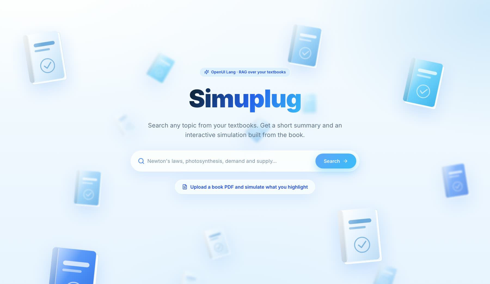
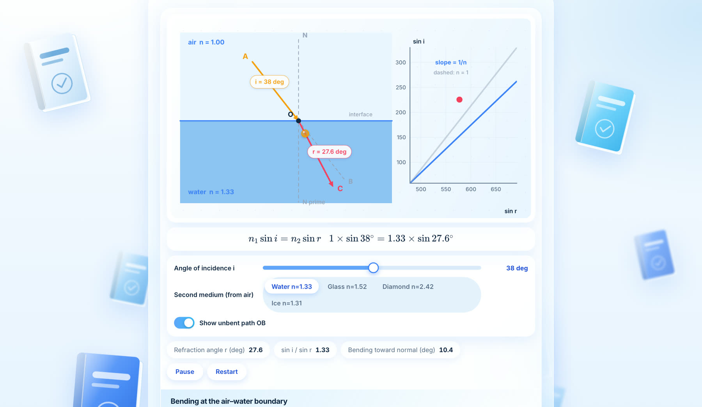
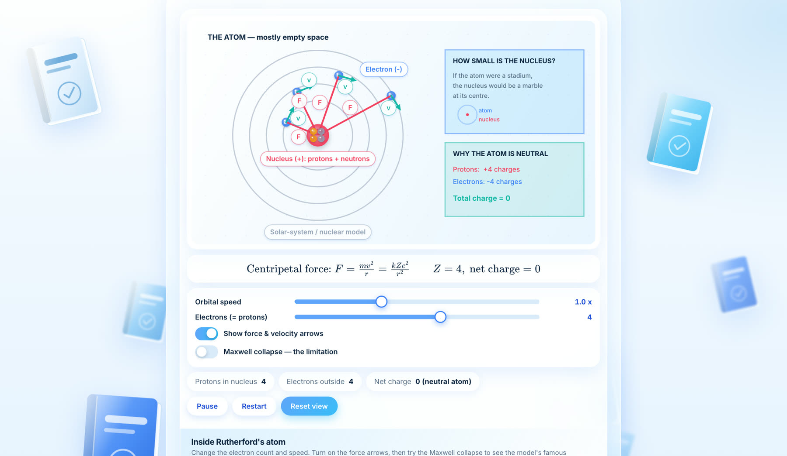
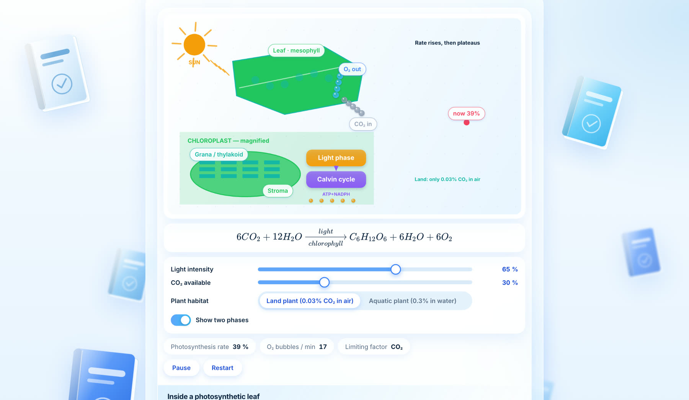
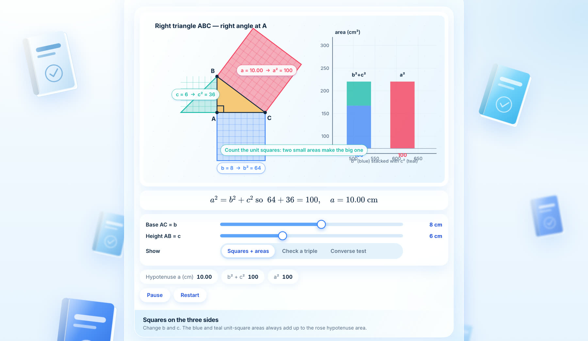
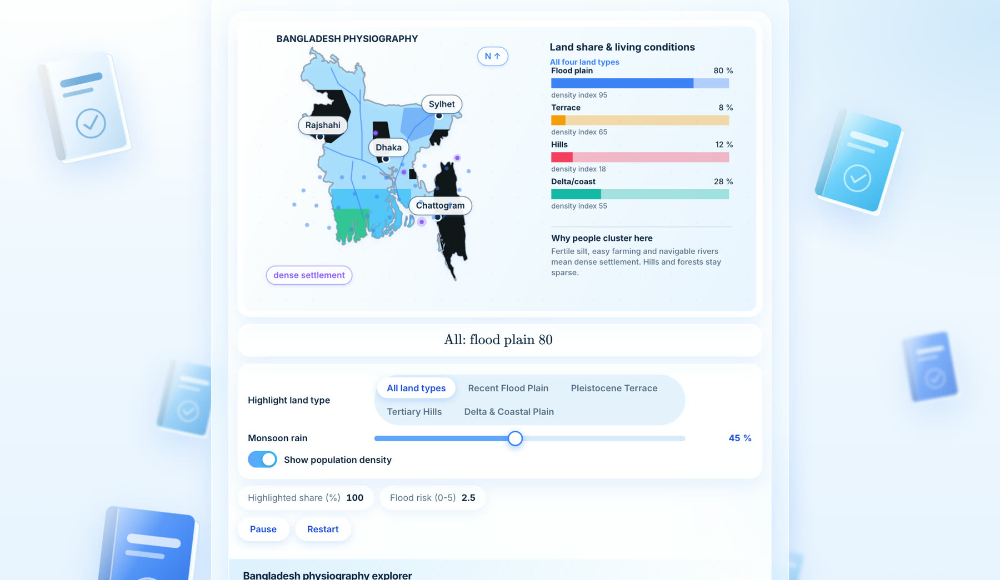
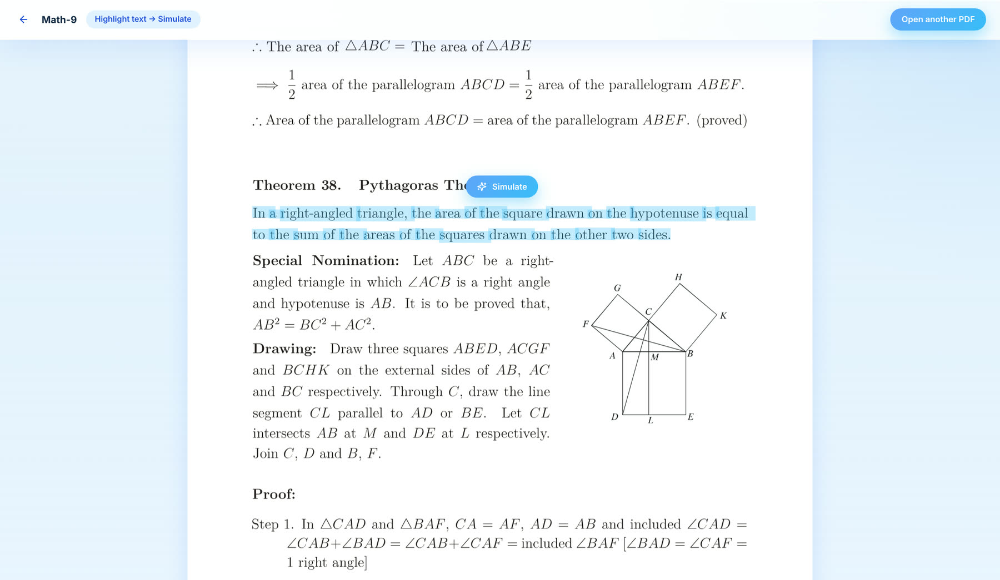
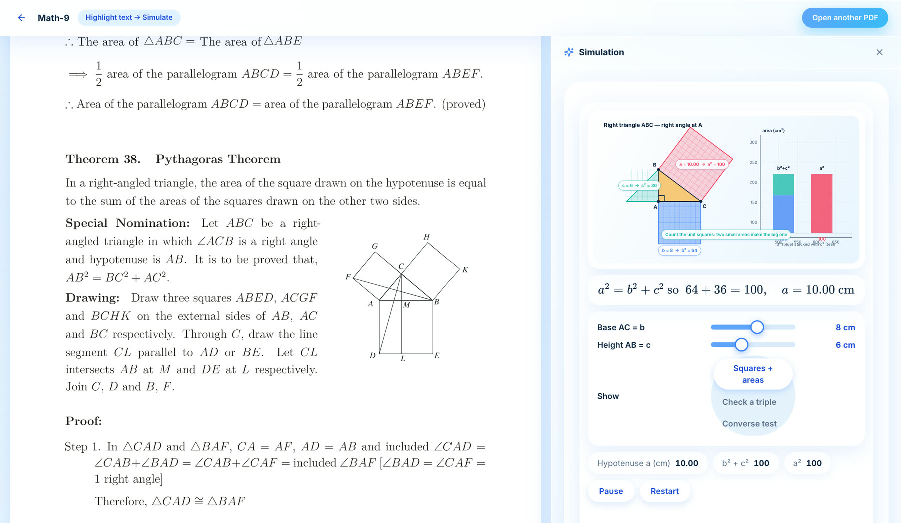

# Simuplug (OpenUI Lang + RAG)

Search any topic from the textbooks in `OCR-Converted-HTML/`. The site returns a short summary and
interactive simulations built from the matching book sections.



## What it looks like

Every result is one interactive simulation at the top, followed by the textbook summary and related topics. Each one below was
written by Muse Wonder 1.0 from the matching textbook section.

| Physics: refraction of light | Chemistry: Rutherford's atomic model |
| --- | --- |
|  |  |

| Biology: photosynthesis | Mathematics: the Pythagorean theorem |
| --- | --- |
|  |  |

**Geography: land configuration of Bangladesh**, drawn on a real border instead of a hand-drawn outline:



## PDF reader

Upload an NCTB textbook PDF. It is matched to a book already stored in Neon (by page count and page shape), and the stored word
positions are laid over the pages as selectable text, so no OCR runs in the browser. Highlight any passage and press **Simulate**:
the simulation and summary open beside the page.

| Highlight a passage | Simulate it beside the page |
| --- | --- |
|  |  |

## Built with Muse Wonder 1.0

All text and simulation generation in Simuplug is done by **Muse Wonder 1.0** (`muse-wonder-1.0`, via the Meta API at
`https://api.meta.ai/v1`). It is used for:

- the short, cited **summary** of the matched textbook section, and
- writing each **simulation** as OpenUI Lang (from the section's figure descriptions, or from its text when there is no figure).

Embeddings are separate and come from EmbeddingGemma 2 (see below).

## How it works

1. **Chunking** – `rag/chunk.py` splits each OCR book into sub-topic chunks (`3.1`, `3.2`, `5.1` …). Books without
   numbered headings fall back to heading-based chunks inside detected chapters. Figure descriptions stay in the chunk.
2. **Embedding** – `rag/embed.py` embeds every chunk with **EmbeddingGemma 2** (`google/embeddinggemma-2`, 768-d, run locally
   with sentence-transformers) and stores it in Neon Postgres (`chunks`, pgvector + HNSW).
3. **Search (RAG)** – the query is embedded with the same model (`rag/embed_server.py`) and the nearest chunks are
   fetched by cosine distance.
4. **Summary** – **Muse Wonder 1.0** writes a short, cited summary from the best-matching chunk.
5. **Simulation** – simulations are stored per *topic* (the search they were made for), not per section, because one section
   can cover several experiments or models. A stored one is reused only if it is the same topic: near-identical searches reuse it
   directly and borderline ones are settled by a tiny Muse same/different check. Otherwise it is generated and stored with the
   search's vector. If one is reused, its stored OpenUI Lang is rendered directly. Otherwise **Muse Wonder 1.0** writes a new OpenUI Lang page (using the chunk's figure descriptions, or the chunk text
   plus outside knowledge when there is no figure), it is validated, rendered, and stored next to the chunk's vector.
   The interactive part is a `SimCanvas` component: a short script run in a sandboxed iframe. Before a simulation is stored it is
   validated and dry-run on the server (syntax, runtime errors, NaN, overlapping text) and Muse repairs it if needed.

## Simulation design system

Every simulation shares one light, glassy look (white + ice blue). The script API (`slider`, `choice`, `formula`, `ball`, `box`,
`label`, `arrow`, `axes`/`plot`, `chart`, `timeline`, ...) is implemented in `src/lib/openui/sim-harness.ts`. Optional libraries are
self-hosted (`scripts/copy-vendor.mjs` copies them to `public/vendor`) and inlined into each sandboxed page only when used:
**KaTeX** for formulas, **Matter.js** for collisions/friction, **Leaflet** for real maps. Maps of Bangladesh use a real border
(Natural Earth, public domain) with regions, rivers and cities via the `bd*` helpers, so the model never draws a country by hand. Charts, graphs and animation are plain
Canvas with `requestAnimationFrame`. The site itself uses Motion for transitions and Inter + Noto Sans Bengali for text.

## Run it

```bash
pnpm install
python3 -m venv rag/.venv && rag/.venv/bin/pip install sentence-transformers transformers "psycopg[binary]" fastapi uvicorn Pillow torchvision
npm run rag:chunk      # OCR HTML -> rag/chunks.jsonl
npm run rag:embed      # embed + store in Neon (resumable)
python3 rag/prep_ocr.py                      # OCR-Word-Positions -> data/ocr (one-time)
cd rag && .venv/bin/python load_ocr.py && cd ..   # load word positions into Neon (one-time)
npm run embed-server   # terminal 1: query embedding service on :8765
npm run dev            # terminal 2: the website (Turbopack dev server; the first visit to each page compiles it)
# For the fastest experience, run a production build instead:  npm run build && npm start
```

Environment (`.env` / `.env.local`): `MUSE_API_KEY`, `MUSE_BASE_URL` (default `https://api.meta.ai/v1`), `MUSE_MODEL` (default `muse-wonder-1.0`), `DATABASE_URL`, `DATABASE_URL_UNPOOLED`.
